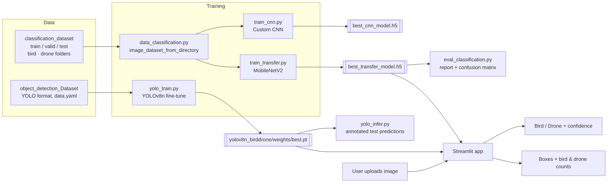

# Aerial Object Classification & Detection – Bird vs Drone

> A computer-vision project that tells birds from drones in aerial images: a MobileNetV2 transfer-learning classifier for single-object images, a YOLOv8n detector that finds and counts every bird and drone in a scene, and a Streamlit app to try both.

<p align="left">
  
  
  
  
  
  
</p>

---

## Features

- **Two classification models** (binary: bird vs drone, 224×224 input)
  - Custom CNN – 3 Conv/MaxPool blocks, dropout, dense head (`src/train_cnn.py`)
  - Transfer learning – frozen ImageNet **MobileNetV2** backbone + global average pooling + sigmoid head (`src/train_transfer.py`), trained with checkpointing, early stopping and LR-on-plateau
- **Object detection** – **YOLOv8n** fine-tuned on a 2-class Roboflow dataset (`Bird`, `drone`) for 15 epochs at 640 px (`src/yolo_train.py`)
- **Evaluation** – classification report and confusion matrix on the test split (`src/eval_classification.py`); batch YOLO inference on the test images with annotated outputs (`src/yolo_infer.py`)
- **Streamlit app** (`streamlit_app/app.py`)
  - *Classification mode* – upload an image, adjust the decision threshold, see the predicted class, confidence and raw drone probability
  - *YOLOv8 detection mode* – adjustable confidence threshold, annotated boxes and per-class counts of birds and drones
- **Trained weights included** via Git LFS (`models/classification/*.h5`, `models/detection/yolov8n_birddrone/weights/*.pt`)

## Tech Stack

| Area | Tools |
|------|-------|
| Language | Python |
| Deep learning | TensorFlow / Keras, MobileNetV2 (ImageNet weights) |
| Object detection | Ultralytics YOLOv8 (`yolov8n.pt`) |
| Evaluation & plots | scikit-learn, Matplotlib |
| Image handling | Pillow, NumPy, OpenCV |
| App | Streamlit |
| Data | Roboflow "drones and birds" dataset (CC BY 4.0) in YOLO format + folder-per-class classification set |

## Architecture



## Project Structure

```
Aerial-Object-Classification-Detection/
├── dataset/
│   ├── classification_dataset/       # train / valid / test, each with bird/ and drone/
│   └── object_detection_Dataset/     # Roboflow YOLO export: train / valid / test + data.yaml
├── models/
│   ├── classification/               # best_cnn_model.h5, best_transfer_model.h5 (Git LFS)
│   └── detection/yolov8n_birddrone/  # YOLO run: weights/best.pt, results.csv, curves, confusion matrices
├── reports/
│   ├── classification_report.txt     # Test-set metrics for the MobileNetV2 classifier
│   ├── confusion_matrix.png
│   ├── accuracy_loss_cnn.png / accuracy_loss_transfer.png
│   └── yolo_predictions/             # Annotated YOLO predictions on test images
├── sample results (custom)/          # Screenshots of the Streamlit app
├── src/
│   ├── config.py                     # Paths, image size, batch size, epochs
│   ├── data_classification.py        # tf.data pipelines for the classifier
│   ├── models_cnn.py                 # Custom CNN and MobileNetV2 builders
│   ├── train_cnn.py / train_transfer.py
│   ├── eval_classification.py
│   ├── yolo_train.py / yolo_infer.py
│   └── check_paths.py                # Local path sanity check (Windows path hard-coded)
├── streamlit_app/app.py
├── yolov8n.pt                        # Base YOLOv8n weights (Git LFS)
└── requirements.txt
```

## Getting Started

### 1. Clone (with Git LFS for the model weights)

```bash
git lfs install
git clone https://github.com/Gonugunta-Venkata-Jayanth/Aerial-Object-Classification-Detection.git
cd Aerial-Object-Classification-Detection
```

> The repository contains ~10,000 dataset images. To fetch only the code and models, use a sparse checkout, e.g. `git clone --filter=blob:none --sparse <url>` followed by `git sparse-checkout set src streamlit_app models`.

### 2. Install dependencies

```bash
python -m venv venv
source venv/bin/activate          # Windows: venv\Scripts\activate
pip install -r requirements.txt
```

### 3. Run the Streamlit app

```bash
streamlit run streamlit_app/app.py
```

Open http://localhost:8501, choose **Classification** or **YOLOv8 Detection** in the sidebar and upload a `.jpg` / `.png` image.

### 4. Train and evaluate (optional)

The training scripts import `config` as a top-level module, so run them from inside `src/`:

```bash
cd src
python train_cnn.py              # custom CNN      -> models/classification/best_cnn_model.h5
python train_transfer.py         # MobileNetV2     -> models/classification/best_transfer_model.h5
python eval_classification.py    # report + confusion matrix -> reports/
python yolo_train.py             # YOLOv8n, CPU    -> models/detection/yolov8n_birddrone/
python yolo_infer.py             # annotated test images -> reports/yolo_predictions/
```

`yolo_train.py` trains on CPU (`device="cpu"`, batch 8); change `device` to `0` to use a GPU.

## Results

All numbers below are taken from files committed in this repository.

**MobileNetV2 classifier – test set** ([`reports/classification_report.txt`](reports/classification_report.txt), 215 images):

| Class | Precision | Recall | F1-score | Support |
|-------|-----------|--------|----------|---------|
| bird | 0.96 | 0.98 | 0.97 | 121 |
| drone | 0.98 | 0.95 | 0.96 | 94 |
| **Accuracy** | | | **0.97** | 215 |

**YOLOv8n detector – validation set, epoch 15 of 15** ([`models/detection/yolov8n_birddrone/results.csv`](models/detection/yolov8n_birddrone/results.csv)):

| Precision | Recall | mAP@50 | mAP@50-95 |
|-----------|--------|--------|-----------|
| 0.861 | 0.704 | 0.795 | 0.510 |

Training curves, PR / F1 curves and confusion matrices are in [`models/detection/yolov8n_birddrone/`](models/detection/yolov8n_birddrone/) and [`reports/`](reports/).

### App screenshots

| Classification | Detection |
|----------------|-----------|
| /classificaion.png>) | /yolo.png>) |

## Dataset

- Detection: **"drones and birds" v1** from Roboflow Universe, exported in YOLOv8 format, license **CC BY 4.0** – https://universe.roboflow.com/new-workspace-x00wt/drones-and-birds-0muie/dataset/1
- Classification: folder-per-class split – train (1,414 bird / 1,248 drone), valid (217 / 225), test (121 / 94).

## Future Work

- Read class IDs from the YOLO model's `names` instead of assuming `0 = bird, 1 = drone` in the app
- Fine-tune the upper MobileNetV2 layers and train YOLO longer / on GPU to lift detection recall
- Video and live-webcam inference with alerts for drones
- Bird species identification
- Move the dataset out of Git (download script or DVC) and add tests / CI

## Author

**GV Jayanth** – [GitHub @Gonugunta-Venkata-Jayanth](https://github.com/Gonugunta-Venkata-Jayanth) · [LinkedIn](https://www.linkedin.com/in/gv-jayanth)
